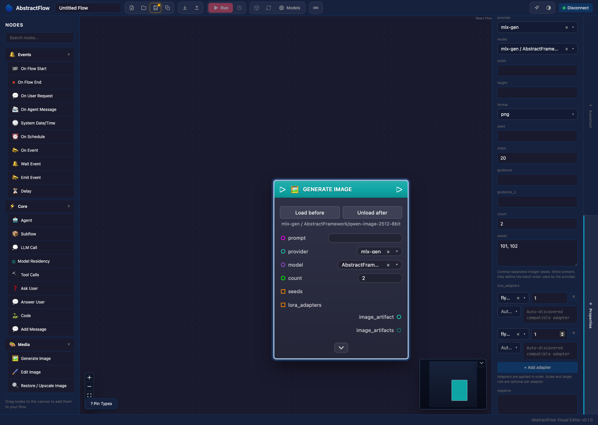

# Web Editor

AbstractFlow is the browser-based VisualFlow editor.

It talks to AbstractGateway for:

- user sessions and runtime routing
- workflow CRUD and publishing
- provider/model/capability discovery
- run start, commands, ledger replay, and ledger streaming
- artifacts, media previews, and generated output downloads

## Run With A Gateway

```bash
export ABSTRACTGATEWAY_USER_AUTH=1
export ABSTRACTGATEWAY_DATA_DIR="$PWD/runtime/gateway"
abstractgateway serve --host 127.0.0.1 --port 8080
```

```bash
npx @abstractframework/flow --gateway-url http://127.0.0.1:8080
```

Open http://127.0.0.1:3003/.

## Browser Auth

Each browser signs in with a Gateway user id and that user's token. Flow exchanges the token with Gateway for an opaque browser session and keeps that session in HTTP-only cookies. Raw user tokens are not retained after sign-in.

Server/operator bearer tokens such as `ABSTRACTGATEWAY_AUTH_TOKEN` are not browser sign-in tokens. Use the Gateway user token, normally the bootstrap admin token for a first local install.

Remote browser-supplied Gateway URL changes are blocked by default. A hosted Flow instance should proxy only to its configured Gateway unless the operator explicitly enables `ABSTRACTFLOW_ALLOW_REMOTE_BROWSER_GATEWAY_CONFIG=1` behind their own access control.

Every request the Flow server sends to the Gateway carries `X-Forwarded-For` set to the browser's address and `X-AbstractFramework-App-Proxy: abstractflow`. The Gateway uses them to tell whether the browser runs on its own computer. Behind the Gateway at `/apps/flow/`, the browser's address is the one the Gateway forwarded; forwarding headers are believed only from a connection on the Flow server's own computer, and browser-supplied ones never reach the Gateway. The Vite development server (`npm run dev`) uses the same session proxy. See [Troubleshooting](troubleshooting.md#sign-in-and-connection) for sign-in and proxy errors.

Opened through the Gateway (**Apps > Flow Editor > Open** in the Gateway console), the editor lives at `/apps/flow/` and the browser arrives signed in. The session cookies there belong to `/apps/flow/` only. See [API and contracts > Serving Under A Base Path](api.md#serving-under-a-base-path).

## Open A Gateway Workflow From A Link

The Gateway console's **Workflows** page has an **Open** button (tooltip "Open in AbstractFlow") on every workflow. It opens the editor at:

```text
/apps/flow/?bundle=<bundle_id>&version=<bundle_version>[&flow=<flow_id>]
```

- `bundle` (required): the workflow id, as listed on the Workflows page.
- `version`: the bundle version. Without it, Flow opens the latest version the Gateway serves.
- `flow`: one flow inside the bundle. Without it, Flow opens the bundle's default entry point.

Once signed in, Flow reads the bundle from the Gateway (`GET /api/gateway/bundles/{bundle_id}?bundle_version=` and `GET /api/gateway/bundles/{bundle_id}/flows/{flow_id}?bundle_version=`) and opens it:

- If the bundle was published from a flow you still have (its `metadata.source.root_flow_id` is one of your flows), Flow opens that flow. Save updates it, as usual.
- Otherwise Flow opens the bundle's flow as an unsaved copy titled `<name> · <bundle_id>@<version>`. Save creates your own flow. Nothing is ever written back into the bundle.
- A workflow that ships with the Gateway shows the notice "Shipped workflow — read-only. Save creates your own copy."

While the flow loads (from a link or from **Open**), a loading screen covers the editor with the flow's name and **Cancel**. Cancel (or Esc) stops the requests to the Gateway; the editor keeps the flow it had and says so.

If the workflow cannot be opened, Flow says why: "This workflow isn't on this gateway any more." when the Gateway no longer has it, the Gateway's own reason when it refuses (for example a workflow an admin made unavailable to users), and "Sign in to the gateway to open …" when the session is missing. The link is read once per page load; reloading the page opens the workflow again.

## About

The About button (the `i` icon in the top-right cluster, between Appearance and the connection pill) opens the AbstractFramework About card: the AbstractFlow version, the AbstractFramework and AbstractGateway versions, links to the website, source, docs, issues, feedback and contact, and one author/licence line. When the card opens, Flow asks the connected gateway for its versions (`GET /api/gateway/about`); it shows only the framework and gateway versions, never a package list. If that request fails, the AbstractGateway line reads `unavailable (...)` with the HTTP status or error.

## Node Palette And Node Cards

The node palette on the left lists every node in one column, with its full
name (long names wrap onto a second line, they are never cut) and a
monochrome icon from the shared AbstractFramework icon set.

- **Icons.** Each node draws the kit icon made for its kind: image, video,
  camera and music for media nodes; a database for stored memory; a branch for
  If and Switch; a loop for Loop, For and While; a variable for the variable
  nodes; minus, divide and a function sign for math. The full set is listed in
  the ui-kit's [Icons](https://github.com/lpalbou/AbstractUIC/blob/main/docs/icons.md) page.

- **Colours.** Each section has one colour: a dot before its name and a tinted
  count, and every node draws its icon in that colour on a faint tile of it.
  A node keeps its home section's colour everywhere — in Essentials, in the
  search results, on its canvas card and in the preview map (On Flow Start is
  an Events and time node, Agent a Core node, If/Else a Control flow node).
  Hover the **Nodes** title for the legend: "Colours mark the node's
  category". Related sections share a colour so the palette stays readable;
  the section name, the icon and the card's badge always say which one it is,
  so the colour is never the only cue:

  | Colour | Sections |
  | --- | --- |
  | Violet | Core (agents, LLM calls, code, subflows) |
  | Orange | Control flow |
  | Aqua | Events and time |
  | Yellow | Variables, Values and schema |
  | Magenta | Data and text, Math |
  | Blue | Files and artifacts, Media |
  | Green | Memory, Entity mind |

  The light and dark themes each use their own step of the same seven hues,
  chosen so neighbouring sections stay distinct for colour-blind readers and
  every label keeps at least 4.5:1 contrast. Red is never a category colour:
  it means a failed run.
- **Sections.** Nodes are grouped into sections with a count: Essentials (the
  eight nodes nearly every flow uses), Core, Control flow, Events and time,
  Variables, Data and text, Values and schema, Files and artifacts, Media,
  Memory, Entity mind and Math. Essentials is open and the others are closed
  the first time; click a section header to open or close it. Your browser
  remembers which sections are open.
- **Search.** Type in **Search nodes** to filter every section at once by name,
  type or description. Sections with a match open and the matching part of
  each name is highlighted. Esc clears the search.
- **Descriptions.** Hover or focus a node to see its one-line description in a
  tooltip. A node that needs a gateway feature your gateway does not offer is
  dimmed, with a warning icon and the reason in the tooltip.
- **Keyboard.** From the search box, Down arrow moves into the list. Up and
  Down arrows, Home and End move between section headers and nodes; Right
  arrow opens a section and Left arrow closes it (from a node, it returns to
  the section header). Enter adds the focused node at the centre of the
  visible canvas, or opens and closes a section.
- **Adding nodes.** Drag a node onto the canvas to place it where you drop it.
  On touch screens, tap it to add it at the centre of the canvas.
- **Width.** On a wide window, drag the palette's right edge (or focus it and
  use the Left and Right arrows) to make it wider or narrower. The narrowest
  width still shows full names; your browser remembers the width.

Every node on the canvas is the same card: a header with the node's icon, its
full title (wrapped, never cut) and a small badge naming its kind (Event,
Core, Control, Value, Data, Math, File, Memory, Variable, Media, Entity,
Artifact, Schema), then the input ports on the left and the output ports on
the right, each labelled and coloured by its type (see **Pin Types**). The
node's category colour (the table above) is the band at the top of its
header, the header tint and the tile behind its icon; the edges keep the pin
type colours.

- **Selection and hover.** A selected node has an accent ring; a hovered node
  lifts with an outline in its category colour.
- **Tap, click and drag.** A tap or a click on a node selects it and opens its
  properties, also when it is already selected. Pressing a node and moving
  beyond a few pixels (about 10 px with a finger, 4 px with a mouse) drags it:
  a drag never selects the node or opens the properties panel, and the node
  you had selected stays selected with its panel open.
- **Run status.** While a run is live, the running node pulses in green, a
  node that just finished glows blue for a few seconds, the node a run is
  waiting on has a dashed amber outline, and the node a run failed on is
  outlined in red. The colours come from your theme, and the header also shows
  the status as an icon with its name in a tooltip (spinner Running, check
  Done, pause Waiting, warning Failed), so the colour is never the only cue.
- **Zoom controls.** The buttons at the bottom left zoom in, zoom out, fit the
  whole flow in view, and **Canvas lock** (pressed = nodes cannot be moved,
  connected or selected), each with its kit icon (magnifier with plus or
  minus, four corners, padlock) and a tooltip. The preview map in the bottom
  right has its own show/hide button.

### If/Else branch order

The up/down arrows button at the top right of an If/Else node swaps the order in which its True and
False outputs are drawn, so the branch whose wire goes up can sit on top. It changes only the
drawing: the runtime ignores it. It is saved with the node.

### Folded operator nodes

Fold an operator node into a small round node with only its sign, its pins and its wires: tap or
click the fold button in its header (any device), or double-click it (mouse or trackpad). Unfold it
with a double-click, or with a tap on a touch screen (a tap on a folded node never opens the
properties drawer). Operators are the math nodes, the
small text nodes (Concat, Length, Is Empty, Contains, Uppercase, Lowercase, Trim), the array and
object builders (Make Array, Array Append, Array Concat, Array Length, Build JSON, Merge Objects,
Break Object), the logic gates, Coalesce and Compare; a Get Variable node folds into a rounded
rectangle that shows the variable's name. Hovering a folded node shows what it is, what
feeds each input (an expression, a variable, another node's output or a literal value) and its
outputs (Break Object: each field with its path, type and schema). The properties panel has a
**Folded** switch for these nodes, and folding is off while the canvas is locked. Values set on
the node are kept, and the folded state is saved with the flow. A double click on a pin or an
inline editor does not fold.

## Responsive Layout

The editor works on a desktop window, a laptop, a tablet, a phone, and a
browser window at any size. The canvas always fills the space between the
header and the bottom of the screen. The side panels change behaviour with
the window width:

| Window | Node palette | Properties, assistant, functions | Dialogs |
|---|---|---|---|
| 1024 px and wider | Docked on the left | Docked on the right, opened from the rail or by selecting a node | Centered |
| 768-1023 px (tablet portrait, narrow window) | Drawer from the left, opened with the palette button at the left of the header | Drawer over the canvas; the rail stays on the right edge | Centered, with a margin around them |
| Below 768 px, or below 500 px tall (phones) | Full-width drawer on phones in portrait | Full-width drawer on phones in portrait | Bottom sheets with the action row pinned at the bottom |

- **Drawers.** Only one drawer is open at a time. Close it with Escape, its ×
  button, or a tap on the dimmed canvas. Selecting a node opens its
  properties.
- **Changing the window size.** When the window narrows below 1024 px, the
  open panels close so the canvas stays visible. When it widens again, the
  panel that was open is docked again.
- **Header.** Between 1024 and 1439 px the toolbar scrolls sideways within
  its row. Below 768 px the header has two rows: the palette button, flow name
  and top-bar buttons, then the toolbar, with Run first.
- **Adding nodes on a touch screen.** Touch screens have no drag-and-drop. Tap
  a node in the palette to add it at the centre of the visible canvas; the
  palette closes so you can see it. The same tap works whenever the palette is
  a drawer. On a desktop with a mouse, drag nodes from the palette as usual.
- **Canvas.** Pinch to zoom and drag to pan. The zoom controls are 44 px on
  touch screens. The minimap starts collapsed on phones and short screens;
  use the toggle in the bottom-right corner to show it. The view fits the
  flow again when you rotate the device.
- **Flow library and run window on phones and tablets.** Below 1024 px the
  library shows the flow list above the preview (side by side in phone
  landscape), and the run window shows the execution steps above the step
  details. Each sheet scrolls as one page; the lists do not scroll inside
  their own box. Sections are flat, with a thin line between items. The
  list's header (**Flows**, **Execution**) hides or shows the list with a
  tap, a click, Enter or Space; lists start open and the editor remembers
  your choice in this browser. On phones the run window uses the width of
  the screen with a 12 px margin, and label and value share a line when they
  fit.
- **Side panel tabs on phones.** The Assistant, Properties and Functions tabs
  sit in a row at the top of the drawer, so the open panel uses the full
  width.
- **On-screen keyboard.** The assistant composer and the sheets' action rows,
  such as the library's Load button, stay above the keyboard. In phone
  landscape a 200 px keyboard leaves room for the composer; a taller keyboard
  leaves less space than the composer needs.
- **Touch targets and text.** Toolbar buttons, palette nodes, library rows,
  selects and dialog buttons are at least 44 px on touch screens. Text on
  touch screens uses a larger scale: body text 14 to 15 px, secondary text
  13 px. Inputs use 16 px text so iOS does not zoom in when you focus them.
  Your font-size setting multiplies every size.
- **Notifications** appear at the top of the screen on phones, clear of the
  sheets' action rows, and at the bottom right elsewhere.

What stays desktop-sized: node cards and the controls inside them (pin
inputs, pin selects, "Edit Code") keep their compact design and scale with
the canvas zoom, so zoom in to work on them on a small screen. On a desktop
with a mouse, the panels keep their dense layout with text at 12 px or more
(secondary text 13 px).

## Switches

On/off settings are switches labelled by what they control; a switch is
highlighted with a check mark when on and plain when off. The properties
panel has **Recurrent** (On Schedule) and
**Free text answers** (Ask User). The dialogs have **Load it into the gateway now**
(Make it available, under Details), **Private workspace per run** (the run window's run workspace),
**Durable** (sending an event to a waiting run), and **Lock after load** and
**Cached and non-resident models** (Resources). When a switch cannot change,
it says why next to it: **Private workspace per run** is fixed while the gateway
manages the workspace or a run is in progress. Pause and Resume on a running
run are buttons, because they act on the run once.

## Provider And Model Discovery

Flow does not store API keys or endpoint secrets. It asks Gateway for provider catalogs, endpoint profiles, model lists, capability defaults, and media route descriptors.

Configure these in the Gateway console:

- OpenAI, Anthropic, OpenRouter, Portkey, Ollama, LM Studio
- custom OpenAI-compatible endpoint profiles
- Gateway-level and user-level capability defaults

Flow nodes then select providers and models from Gateway discovery.
Leave provider/model as **Auto (Gateway default)** when a workflow should use
the Gateway/Core capability route configured for the current runtime. This is
the portable default for LLM Call, Agent, and generated media nodes. If you pin
a provider and later want to return to runtime defaults, choose **Auto (Gateway
default)** again from the provider dropdown.

## Resources

The toolbar's **Resources** button opens the Resources panel, which reads
Gateway's model-residency, host-state, and session-cache endpoints across
three tabs:

- **Models** lists the models Gateway reports for the current runtime: a
  modality chip (colored from Gateway's `modality_ui` contract), provider,
  model, a tri-state Resident pill (Yes / No / Unknown), size, and context
  length (✓ marks a calibrated value). Locked models carry a lock marker;
  Lock/Unlock and a per-model context Estimate appear when Gateway advertises
  those endpoints. Unloading a locked model asks for an explicit Force Unload
  confirmation. The **Cached and non-resident models** switch reveals cached
  and configuration-only rows, and the load bar's **Lock after load** switch
  locks a model as part of loading it.
- **Memory** shows host RAM, device, and per-GPU meters, process RSS, and
  degraded-state reasons from Gateway host state, refreshed every 5 seconds
  while the tab is open.
- **Session caches** lists per-session prompt caches and clears a session's
  caches after confirmation.

The panel manages loaded models; it does not edit capability defaults.
Configure capability defaults in Gateway Console or with the Gateway/Core
config CLIs; changing a default does not load or unload a model.

## Flow Interfaces

When AbstractFlow opens on a blank canvas, it offers **Create Flow** (the New flow dialog) and **Open Flow** (the Flow Library) side by side; the toolbar's **New Flow** and **Open Flow** buttons do the same at any time.

**New Flow** first asks **What starts it?**, then the workflow's title, an optional description and the interfaces it declares (the same interface list as the Flow Library, with each interface's pins). The four answers are:

- **A person, in a chat** (the default): a flow for chat, created as before.
- **On a schedule**: every day, every week (pick at least one day), every month, every few minutes or hours, or once on a date, at a time of day (24-hour hour and minute). **Time zone** starts on your account's time zone from the gateway (else this browser's) and can be changed for this automation. The sentence under the editor reads the schedule back, for example "Every Monday and Thursday at 07:30 (Europe/Paris)".
- **When something arrives**: grouped as **Your mailboxes** (by address: "When mail arrives in me@example.org"), **Your feeds** and **Your webhooks** (by name: "When Release notes has a new item", "When CI hook is called"). A paused, switched-off or failing one is listed with its state ("paused", "not working: The feed answered HTTP 404. Check the feed address."). **Add a mailbox…** opens the gateway console's account page and **Add a feed or webhook…** its Triggers page; **Refresh** reads the lists again.
- **By hand (Run now only)**: the automation runs only when someone presses Run now.

Each choice shows one line saying what it does. Once a trigger is chosen the dialog says "Runs by itself when its trigger fires: what arrives is on On Flow Start, build the steps on the canvas." and has no Interfaces section. A triggered flow is your own workflow: **Create automation flow** opens it with only `On Flow Start` and `On Flow End`, nothing between them, and a note over the canvas: "What arrives is on On Flow Start; put what the person should see on On Flow End's response (and notify for an alert)." (dismiss it with ×; **Automation…** opens the dialog). See [What arrives, what the person sees](#what-arrives-what-the-person-sees). Otherwise **Create flow** places the `On Flow Start` and `On Flow End` nodes the declared interfaces need, already carrying their pins; you build the steps between them. **Save Flow** stores the title, description, interfaces, automation and nodes on the gateway. If the open flow has unsaved changes, the dialog says creating a new flow discards them.

The header shows what the open flow is, next to its name: **Automation · Every day at 08:00 (Europe/Paris)** or **Automation · When mail arrives in me@example.org** for an automation, **Chat** for a runnable flow without one, and a dashed **Automation…** otherwise. Click it for **Automation…** (the dialog on the open flow; its changes are saved with the flow) and **Turn it on**. The badge keeps the word "Automation" and shortens the sentence when the header is narrow. The Flow Library shows the same line under each workflow's name; flows with the same name are told apart by their size ("3 nodes · 1 edge").

To change the interfaces of an existing workflow, open the **Flow Library**, select a workflow and use the edit button next to **Interfaces** to declare the contracts it implements (for example **Runnable agent (v1)**). The interfaces are listed one per line; ticking or inspecting one opens its details beside the list, with the `On Flow Start` and `On Flow End` nodes drawn with the pins it requires. The footer carries **Cancel** and **Save Interfaces**. Saving adds the missing ones to the `On Flow Start` and `On Flow End` nodes: right away when the workflow is open in the editor (your unsaved edits and undo history are kept, and the flow shows unsaved changes until you **Save**), otherwise the next time you open it. Wire the added pins on the canvas so hosts get real values. See [VisualFlow JSON > Interfaces](visualflow.md#interfaces) for the pins of every interface.

## Automations

An automation runs a published workflow again and again: on a schedule, when mail or a feed item or a webhook call arrives, or only when someone presses Run now. You create, pause and delete automations in Observer or the Assistant (or with `POST /api/gateway/automations`). The editor stores what an automation made from a workflow starts with, in the workflow's `automation_defaults` field.

Open the **Automation** dialog from the header badge of the open flow, from **New Flow** (a trigger choice opens the flow with it already set), or from the **Flow Library**: select a workflow and use the edit button (**Automation…**) next to its **Automation** row, which reads the trigger back ("Every 15 minutes", "When CI hook is called"). The dialog says, in one sentence, what happens: when the trigger fires, the flow runs with these inputs. It has four parts:

- **What starts it?** The same choices as New Flow, without chat: **On a schedule**, **When something arrives** (your mailboxes by address, your feeds and webhooks by name) or **By hand (Run now only)**. A schedule is saved as `schedule` version 2 (calendar rules in your time zone); a workflow saved with an older fixed-interval schedule shows it ("Now: Every 5 minutes · an older schedule") and keeps it until you change the schedule. A mailbox is saved as `trigger.config.account`; a feed or webhook as `trigger.connection_id`. **More settings** shows the chosen trigger's other settings in plain words, built from its schema: for mail, the folder, how often new mail is gathered into one run, how many messages per run, automatic messages, and **Only mail that…** (comes from, comes from the domain, is sent to: one address or domain per line; has in its subject; has an attachment). Empty settings use the trigger's defaults.
- **Context.** **Independent** (every run starts fresh) or **Growing** (every run continues the same conversation). Growing shows **Remembers up to N tokens of earlier runs**, filled with the gateway's one default (`GET /api/gateway/automations/defaults`, `growing_max_tokens`). Keep it to follow that default wherever it changes; a different number is saved as `context.growing.max_tokens`. A larger budget lets each run build on more of the earlier runs and costs more tokens and time per run.
- **Inputs.** Only the workflow's own `On Flow Start` inputs, the ones the trigger does not fill (never `event`, `messages`, `items`, `calls`, `scheduled_at`…): a `prompt` input is **What each run is asked to do**, **Provider** and **Model** are lists from the gateway with **Use the default (…)** first, text, number and yes/no inputs get matching fields with their labels, and an object or list input a small JSON field of its own. A flow without its own inputs says "This flow takes no inputs besides what arrives." **Advanced: raw JSON** holds any other input as one JSON object.
- **Name** (optional): how automations made from the workflow are named in Observer and the Assistant; empty uses the workflow's name.

A flow has one automation. Once it is on, the dialog and the header badge's menu say **On · see it in Observer** and offer **Update the automation** (it is revised to the flow's saved trigger, context and inputs, on the newly available version: `PATCH /api/gateway/automations/{id}`) and **Turn it off** / **Turn it back on** (pause / resume); Turn it on never creates a second one. Flow remembers which automation a flow turned on in this browser, and otherwise finds it among your automations by its flow.

**Turn it on** saves, makes the workflow available (below) and creates the automation through the gateway (`POST /api/gateway/automations` with the published workflow and the saved trigger, context and inputs), then says "Release digest is on. See it in Observer or the Assistant." with **Open Observer**. A refusal is said in words (a feed or mailbox that is no longer yours, an expired session). Pause or stop it in Observer or the Assistant.

**Save** checks everything and names each problem in words (for example "Comes from: "x" is not an email address"); the problems stay visible above the buttons. When the workflow does not have the trigger's inputs yet, Save adds them to `On Flow Start` (and `response`, `notify`, `success` to `On Flow End`) in the same save; it never adds a node. From the Flow Library the workflow is updated on the gateway (`PUT` on the workflow, with its nodes when pins were added) and the answer must contain the stored defaults, else the dialog shows an error instead of reporting a save; if that workflow is open in the editor, the change is applied to it and your unsaved edits are kept. From the header badge the change goes into the open flow and is saved with it. **Remove automation** clears the field. **Save**, **Duplicate** and **Make it available** carry the field with the workflow; see [VisualFlow JSON > Automation Defaults](visualflow.md#automation-defaults) for the stored shape.

**Make it available** (the toolbar, and part of Turn it on) makes the saved workflow available to Observer and the Assistant: "Release digest is ready for Observer and the Assistant." Each time adds a new version and keeps the earlier ones; the gateway name, the version and **Load it into the gateway now** are under **Details**.

The dialog does not set tool approval. When an automation is created, the gateway applies its default policy, in which creating the automation counts as consent for the tools the workflow uses; a creation request that sets `policy.tool_approval` to `ask` makes every run wait for approval instead. Questions from `Ask User` nodes always wait for a person.

### Trigger-Source Discovery

The editor reads the discovery path from the gateway's capabilities (`contracts.common.automations.trigger_sources_endpoint`) and falls back to `GET /api/gateway/trigger-sources`. The answer is kept per gateway URL; a failed request is not kept, and **Try again** asks again.

- When the capabilities report automations as unavailable, or the gateway does not serve the route (HTTP 404), the dialog shows that trigger sources are unavailable on this gateway.
- Any other failure, including an answer that does not match the trigger-source contract (`id`, `version`, `label`, `config_schema`, `event_schema`, `capabilities.kind` of `time`, `manual` or `event`, `available`; `needs_connection` a boolean when present, and a `connection_schema` object when it is true), is shown as a discovery error. A descriptor without `needs_connection` (a gateway that predates connections) needs no connection.

### Settings Validation

The settings form and its checks come from each trigger's `config_schema`. The editor renders text, numbers, yes/no, choices, durations, date-times, lists of strings (one per line) and nested objects (a section of fields), and checks `type`, `properties`, `required`, `additionalProperties`, `enum`, `pattern`, `minimum`, `maximum`, `minLength`, `maxLength`, `items`, `minItems`, `maxItems`, `uniqueItems` and the formats `date-time`, `duration`, `email` and `uri`. A setting whose schema uses another keyword is shown as a JSON field of its own and checked by the gateway; it never blocks the trigger. Defaults that name an unknown trigger, an unavailable one, or a version the gateway does not serve are refused with a message. The gateway validates the defaults again when you save and when an automation is created.

### What arrives, what the person sees

A triggered flow reads what arrived on `On Flow Start`, as typed, named outputs (hover one for its description):

| Trigger | `On Flow Start` outputs |
| --- | --- |
| Mail | `messages`: the new mail, each `{id, from, to, subject, date, body_text, attachments}`; `mailbox`: the address it arrived in |
| Feed | `items`: the new items, each `{id, title, link, published, summary, author}`; `feed`: `{title, url}` |
| Webhook | `calls`: the calls received, each `{id, received_at, headers, body}` |
| Schedule | `scheduled_at` (when the run was due), `occurrence` (run #1, #2, …) |
| By hand | nothing extra |

Every triggered flow also has `event`, the whole raw event. Your own inputs (a threshold, a `prompt` if you want one) stay on `On Flow Start` and are set under **Inputs** in the Automation dialog. `On Flow End` takes what the run gives back: `response` (what the person sees as the run's result), `notify` (optional `{title, body}`: an alert on the watch, the tray and the Assistant) and `success` (false marks the run failed: it is retried, then an alert says so). Saving a triggered flow with nothing connected to `response` saves it and says so. The runtime's side of this contract: [AbstractRuntime > Occurrence inputs and outputs](https://github.com/lpalbou/abstractruntime/blob/main/docs/automations.md#occurrence-inputs-and-outputs-the-flow-contract).

In that window, a triggered flow keeps the session, the prompt caches and the run and step ids behind **Advanced settings**; its result shows what the person sees (On Flow End's `response`), or "Each run's result will be empty unless something is connected to On Flow End's response.", with the whole result under **Details**, and the finished test run says "Test run done with the latest 3 items of Python news". Time zones are a short list of cities with their offset ("Paris (UTC+1)"), yours first; search for any other.

**Run as if triggered.** Pressing **Run** on a flow with an automation trigger opens the run window with **Run as if triggered** first: "Using: When mail arrives in me@example.org", one control (**Use the last [100] messages**; items for a feed, calls for a webhook; nothing for a schedule or by hand) and one sentence saying what **Run** will do ("Run reads the last 100 messages of me@example.org again and runs the flow on them."). The window has one **Run** button, at the bottom. Every Run asks the gateway for a fresh sample with the current count (`POST /api/gateway/triggers/sample {trigger, count}` → `{inputs, truncated, summary}`), fills those inputs and starts a normal run with them, saying "Running with the last 100 messages of me@example.org (test run)", or "Only 3 messages found: running with them (test run)" when fewer came back, with "(stopped after 20 s)" when the gateway stopped reading early. Nothing is turned on. Your own inputs stay under **Your inputs**; what the trigger fills (`messages`, `mailbox`, `event`, …) is under **Advanced: edit the inputs**, filled from the last sample. Only typing in them counts as editing: the panel then says "Using your edited inputs." with **Use the sample again**, and Run uses your values until then (each opening of the window starts fresh). A failure is said in words (a mailbox that cannot be reached, a feed that answered 404). Flows without a trigger keep the plain run window.

**Worked example: a safe-mail judge.** A mail trigger, and a deterministic flow that never lets a model act on untrusted mail with tools:

1. `On Flow Start`: `messages` (an Email list) → **ForEach** (each `item` is an Email).
2. **Email fields** on the item (`from`, `subject`, `body_text`) → **String Template** → **LLM Call** with **no tools**, `system` "Is this mail safe to act on? Answer yes or no, and why.", and a `resp_schema` `{safe: boolean, why: string}` (structured answer).
3. **Break Object** on the LLM Call's `data` (`safe`, `why`) → **If/Else** on `safe`.
4. True: **Mark as read** (the item) → **Add label** `["triaged"]` (the item) → **Notify me** (`title` "Triaged", `body` ← the subject); a second **LLM Call** can summarise it for `On Flow End` `response`.
5. False: `On Flow End` `response` ← `why`, and `notify` ← a **Build JSON** `{title: "Suspicious mail", body: why}`.

Turn it on from the Automation dialog: each new mail runs the judge; safe mail is marked read and labelled, and only a suspicious one raises an alert.

### The Trigger Event

The **Trigger event** node is an optional helper for the raw envelope: most flows read the named outputs above instead. A run an automation starts receives the event that caused it as `event`. A workflow created with a trigger, or saved with one in the Automation dialog, already has the `event` output; to break it into fields, select the workflow's **On Flow Start** and press **Add trigger event** (Properties): the node gets an `event` output (the CloudEvents envelope, typed so path pickers know its fields) and a **Trigger event** node (a Break Object) is wired to it, with the outputs `type`, `subject`, `time`, `data`, `count`, `events` and `series`. A feed or a webhook delivers a batch: `count` items in `events`, oldest first, each with its own `data` (a feed item's `title`, `link`, `published`, `summary`; a webhook call's `body`); loop over `events` (For Each) or add a path such as `data.events.0.data.title` to the Trigger event node. `email.received` lists the messages in `data.messages` (the bodies are the run's `emails` input); `series` is a schedule's occurrence (`occurrence`, `scheduled_at`, `next_at`). When the workflow is run by hand, `event` is empty. Examples per source: [VisualFlow JSON > The trigger event](visualflow.md#the-trigger-event).

A workflow with the `event` output is *triggerable*. **New Flow** with a trigger and **Save** in the Automation dialog add it (and the named outputs) for you; the Trigger event node is never placed by default. See [VisualFlow JSON > The trigger event](visualflow.md#the-trigger-event) for the envelope's fields.

`On Schedule`, `On Event` and `Delay` (`wait_until`) are different: they wait inside a run that has already started and never start a workflow. See [Workflow node catalog](workflow-node-catalog.md).

## Mail

The **Mail and publish** section of the palette handles mail deterministically, with no model: each node is one fixed action of the runtime (`mail.*`) on a mailbox of yours, and a refusal (a read-only mailbox, a message the server no longer has) comes back as `success` false with the reason in `result`.

- **Email** is a data type: one email has `id` (where the message is: what the mail nodes act on), `message_id`, `mailbox`, `folder`, `thread_id`, `from`, `to`, `cc`, `subject`, `date`, `body_text`, `body_html`, `attachments` (`index`, `name`, `size`, `type`), `seen`, `flagged` and `labels`; hover an Email pin to see them. A mail trigger's `messages` is an Email list; **ForEach** over an Email list gives one Email per item, which the mail nodes take as it is. **Email fields** turns one Email into a pin per field.
- **Search mail** (mailbox, folder, limit; in Properties: from, to, subject has, contains, since, until, unread only, flagged only, with labels) gives an Email list, newest first, without bodies; **Get mail** reads emails with their bodies.
- **Mark as read**, **Mark as unread**, **Flag**, **Unflag**, **Add label**, **Remove label**, **Move to folder** (pick the folder in Properties: the mailbox's folders, special ones with their role, e.g. "[Gmail]/Trash · Trash"; when the gateway cannot list them, type the name) and **Delete** (to the Trash; **Delete for good** under More options) change the emails they are given. **Mark mail** and **Label mail** do several of these at once.
- **Send mail** (to, cc, bcc, subject, text, html, attachments), **Reply** (reply all) and **Forward** (to, note) send through your mailbox's recipient policy; **Get attachment** stores one attachment as a file.
- **Mailbox**: every node has a mailbox picker in Properties (your mailboxes by address). Empty means the trigger's mailbox, else your main one. Sending from a read-only mailbox (no outgoing server) is refused there, in words, before you run anything.

## Publish

**Publish to channel** sends a message (channel, type, title, body, subject, data) that any application subscribed to that channel receives (`GET /api/gateway/me/events?channel=…`). Channel names use lowercase letters, digits, `.`, `_` or `-`; `attention` is the gateway's own. Turn on **Also notify me** to be notified on the tray, the Assistant and the watch as well. **Notify me** is the short form: a title and a body, and you are notified.

## Relays and the wire-drop menu

Release a dragged wire on empty canvas (away from any pin or node) and a small menu opens there:

- **Relay** adds a dot wired to the pin you dragged from. Drag from the dot's right half to as many
  inputs as you need: one output then feeds several inputs along a tidy path. A relay takes the type
  of the wire that feeds it (its colour, and the connection checks, follow it); relays can be
  chained. It is visual only: when the flow runs, the runtime wires the source straight to each
  input, as if the dot were not there (AbstractRuntime `reroute_lowering.py`, which must be deployed
  for a flow with relays to run).
- **If/Else** (from a boolean output, listed first) adds an If/Else whose `condition` is that
  output; wire its execution input and its `true` / `false` outputs to the steps around it.
- **Break Object** (from an object or `any` output) adds a Break Object wired to it and opens its
  properties, where you pick the fields.

Execution pins get no menu: relays carry data only. The relay and its wire are one undo step. A
relay is also in the palette (Data and text → Relay).

## Several entry paths into one node

A node can be entered by several execution wires, for example a ForEach entered from the Planner
and again from a reviewer's If/Else **False** to redo work with new tasks. Each input then takes
one value per entry path. Its normal wire (or value) feeds every path; a **per-path wire** replaces
it on one path. To draw one, drag a second wire onto the input: the editor asks "when entered
from" which path (Planner, If/Else / false, ...), then draws the wire dashed, labelled
"when from If/Else / false". Dropping another wire on the same path replaces it, and deleting
the wire puts the normal value back on that path. When the wire comes from the node that runs
right before the node on one path, that path is chosen without asking. The node's properties
panel lists the same values under **Multi-entry routing**, one choice per input and path; the
canvas and the panel edit the same wires. At run time the runtime picks the value for the path
that arrived (`multi_entry_lowering.py` in AbstractRuntime).

## Paths that repeat

An execution wire that goes back to an earlier node (an If/Else **False** wired back to a
ForEach, for example) makes that path repeat. The editor finds such wires and shows a **↺** badge
halfway along each one. Click the badge and say how many times at most the path may repeat: the
badge then reads **↺3**, and the limit travels with the wire; nothing else to place or wire. When
the limit is reached the wire is not taken and the flow goes on past the If/Else, on its other
branch (the report, for example). The run checks warn when that branch is unwired, or when the
wire starts from something other than an If/Else: the path then simply ends at the limit (inside
a loop body it returns to the loop; at the top level the run ends). Each pass of an enclosing
ForEach counts on its own. For a round number or an explicit exit, place a **Loop Limit** node on
the loop instead (its **count** is the pass number); the badge then shows faint. A wire that goes
back out of a loop body (an inner ForEach's If/Else wired back to the outer ForEach) shows the
badge greyed, the run checks refuse it, and the runtime refuses the flow at compile time with the
same words: "Wire S.pin -> T goes back out of L's loop body: the run would never end. A path inside
a loop body can only repeat within the body; to repeat the whole loop, wire the loop-back after
the loop's done." (backlog 1018).

## Hidden Connections

Some workflows wire pins the editor cannot draw: a code node's returned keys and a subflow's `child_output` are resolved by name when the workflow runs, but they are not declared pins, and a few connections (for example a model into a plain string pin) are refused by the editor's connection rules. AbstractFlow keeps these connections exactly as stored and saves them back. A node that has any shows an **N hidden** badge in its header; hover it to list the connections (`source.pin -> target.pin`). They disappear from the saved workflow only when you delete one of their nodes. Opening or importing such a workflow also shows a notice listing them. Only a connection to a node that does not exist is removed, and the notice says so. Drawing these connections as editable pins is planned (backlog 0157).

## Code Node Editor

A Code node's **Code** field opens the editor modal: you edit only the body of
`transform(_input)` (the `def` line and the "Available variables" header are kept
for you), the right column lists the variables the body can read (`_input`, then
one variable per input pin with its access expression), and **Test code** runs the
body on the JSON test input through the gateway's sandbox and shows the result or
the sandbox's refusal. The sandbox imports Python's standard library (`import json`,
`re`, `datetime`, `math`…) and refuses the modules that reach the machine; the
returned value must be JSON data (a module or a function in the return is reported
with its place).

Below the test input sits the **Code assistant**: a chat with the gateway's default
text model (the `output.text` capability default, shown in its head) that knows this
node — the workflow and node names, the variables, the current body, the test input
and the sandbox's import rule — and answers in Python. Describe what you need
("add the current date to the output", "validate the input and return an error
when a field is missing"); every reply that carries code offers **Insert into
editor** (replaces the body; Save keeps it) and **Copy**. Each question is one
`basic-agent` run on the gateway; **Stop** abandons the wait. The assistant needs a
configured default text model; without one its head says so and the composer stays
disabled.

## Docs Assistant

The book icon in the top bar opens the **Docs assistant**: the same chat as the Gateway console and the other apps, separate from the Authoring assistant below. It answers questions about AbstractFlow from its llms.txt (the editor serves it at `/llms.txt`; the Gateway reads it at `GET /api/gateway/docs/corpus?app=flow`) through the Gateway's docs-qa workflow, in its own Gateway session. Questions sit on the right and answers on the left with Markdown, code and links; you can attach files, each message has **Copy**, the answer streams when the Gateway's **Streamed replies** setting is on, and the icon in its header starts a new conversation.

## Workflow Authoring Assistant

The star button on the right side of the toolbar opens a conversational
assistant in the right drawer. The drawer shares space with Properties, so users
can switch between assistant guidance and node editing while keeping the canvas
visible.

The assistant uses `docs/workflow-authoring-skill.md` plus a complete generated
node catalog from `src/types/nodes.ts` as its graph-authoring context. This
replaces generic `llms-full.txt` context for workflow construction. By default
it resolves Gateway's configured `output.text` capability route and starts a
short-lived Gateway `basic-agent` planner run through the normal
`/api/gateway/runs/start` path. Users can pin a specific assistant
provider/model from the drawer. The assistant authors the workflow as one
complete JSON document (direct document authoring): each cycle the model emits
the full graph — every node and edge — and the editor diffs that document
against the current draft, compiles the diff into validated graph mutations,
applies them, and continues until the model declares the request satisfied or
is explicitly blocked. Anything the document omits is deleted, so removals are
implicit and the assistant never asks the user to delete nodes manually. The
first cycle aims to one-shot the workflow; later cycles exist to repair
validator errors, readiness issues, and acceptance findings.

Completion is model-owned: readiness checks are a structural floor that can
demand more work, but they never stop the loop while the model returns
`continue`. When the model declares `done` with clean readiness, the editor runs
an acceptance review — a second model pass that compares the draft graph against
the original request and the model's own declared acceptance criteria. Unmet
findings are fed back into the loop as issues; if the review budget is exhausted
the remaining findings are reported with the result instead of being hidden.

The planner run receives a single prompt plus a system prompt with strict JSON
instructions. Its runtime tool list is explicitly empty: authoring edits must
come back as the workflow document JSON, not as Gateway tool calls. Prior turns
are included inside the current prompt through the history window: the newest
whole turns up to 50,000 estimated tokens (AbstractRuntime's rule, ADR-0026). No
turn is cut, so the pending items of a long plan survive across turns. The block
states how many turns it holds, and a labeled `#TRUNCATION` line gives the count
when older turns are dropped. Applied cycles within a turn carry one-line notes
of the model's own next steps. After a test run, the next cycle reads every
failed step with its whole inputs, the run's inputs and, on a pass, its whole
outputs. The visible graph remains the source of applied draft state.

Session policy (revised 2026-07-11, backlog 0112): the per-workflow session id
remains the conversation identity — scoped to the workflow storage key (never
shared across workflows), following a draft when it is promoted to a saved
flow, and rotated by Clear Chat — but planner runs are SESSIONLESS. The
gateway agent replays session memory into the model context; with a shared
session, cycle N re-billed cycles 1..N-1's prompts and responses even though
the client prompt already carries the conversation, cycle notes, and current
document explicitly. Session-carrying run starts also mint a persistent
session-memory owner run per new session server-side, so per-cycle derived
sessions would leave one orphan run per cycle — omitting the session id
avoids both. Continuity across turns lives in the client-persisted
conversation block. The prompt still anchors a language directive at the
request site and marks replayed conversation as historical, so the active
request — not history in another language — controls the output language.

Prompt placement is cache-first (backlog 0112): the large stable context
(authoring skill, node catalog, gateway tool schemas) is byte-identical
across cycles within a turn and rides the SYSTEM message — the runtime
prepends a volatile grounding envelope (with a second-resolution timestamp)
to every user prompt, so only system content can form a wire-stable prefix
for provider caches. The user prompt carries the volatile block
(conversation, authoring brief, current document, the active request).
Nothing is dropped — placement only (ADR-0026 forbids lossy compaction).

Plan responses are parsed tolerantly: the JSON object is extracted even when the
model wraps it in markdown fences or surrounding prose. A planner response that
is still unusable (empty run output, or truncated/invalid plan JSON) does not
abort the turn: the same cycle is retried with a corrective format note (bare
JSON only, shorten free-text fields rather than the graph document), up to
three unusable responses per turn. Each retry is logged in the activity feed.

A `continue` cycle whose document matches the existing graph exactly (no
changes) does not abort the turn either: the model gets a corrective note
(emit a document that addresses the issues, declare done, or ask the user) for
up to two consecutive unchanged cycles, after which the turn ends as "needs
your input" with the model's own reply — never as a hard authoring failure. The system
prompt and skill explicitly tell the model to return `needs_user` with concrete
questions when the request is ambiguous or repair cycles stop making progress;
the user's answer in the next turn resumes with the full draft graph and
conversation context. All user-visible workflow content (flow name, labels,
prompts, replies) must match the language of the user request unless the user
asks otherwise.

While a turn runs, a live status card shows the current phase with the cycle
number in the header, an elapsed timer, and a real-time activity feed (plan
request/response sizes, per-cycle token usage read from the Gateway run-tree
ledgers with cumulative turn totals in the footer, compiled document change
counts, applied changes with labels, document issues, retries, readiness
counts, and acceptance review events). A shimmering in-flight ticker pinned at
the bottom of the feed shows what the assistant is waiting on right now — the
request purpose ("authoring the full workflow document", "repairing 2
validation issues", "acceptance review") — with a per-stage elapsed counter
that ticks every second.
Feed entries are grouped under per-cycle divider rows so iteration boundaries
are scannable at a glance. The header carries a leading chevron with a hover
state (collapse toggle) and a copy button that exports the whole activity feed
— grouped by cycle, with elapsed timestamps — to the clipboard. The card
persists after the turn ends with its final state (green dot for "Draft graph
updated", red dot for "Authoring failed" or "Interrupted by user") so the
cycle history can be reviewed post-turn. A Stop control — in the status card
and in place of Send while busy — interrupts the autonomous loop between calls
and best-effort cancels the in-flight Gateway planner run; applied edits stay
in the draft and remain undoable via Undo Turn.

Conversation actions are compact icon buttons on the input row (copy
conversation, clear conversation, undo last turn) next to the Send/Stop button;
the estimated context usage appears above the model row while a request is
typed or running. AbstractFlow does not truncate the assistant conversation,
selected docs sections, or graph summary to fit a local limit, and it does not
hardcode model context windows. The drawer conversation and draft text are
persisted locally so closing and reopening the Assistant rail does not erase
the ongoing authoring discussion. Clear resets the local assistant
conversation, rotates the workflow's durable Gateway session, and clears the
persisted status card without changing the current graph. If the Gateway run, model call, structured
response, or ledger read fails after the retry budget, the drawer reports that
failure directly.

Assistant output is treated as an untrusted edit proposal. The emitted
document is compiled by a diff against the current graph into the editor's
internal validated command set (node creation/deletion, safe dynamic pins,
pin defaults, pin expressions, literals, Code node bodies, labels, concat
separators, and validated connections), so every existing validator and
security guard stays
the single source of truth for graph mutation. The reducer rejects unknown
node types, invalid edges, secret-looking values, Code `full_access`, and Tool
Calls nodes without an explicit `allowed_tools` allowlist. Node deletions are
allowed as part of document ownership and remain recoverable with Undo Turn;
secrets are serialized to the model as `<redacted>` and the diff never writes
that sentinel back. `pin_defaults` and `pin_expressions` merge per key (an
empty-string expression removes one), node ids are stable identities (a type
change requires a new id), existing node positions are never moved, and new
nodes without explicit positions get execution-depth auto-layout.

Compiled changes are applied per-command in dependency order (nodes first, then
configuration, then connections, with disconnects before connects). Valid
changes are kept even when others fail; the failures are reported back to the
planner as document-issue feedback for the next cycle. The validator also
performs deterministic repairs that a human author would make: connecting an
already-connected execution output is rewired through an auto-inserted (or
extended) Sequence node, and loop-back edges from a loop body to the loop's
`exec-in` are dropped with a warning because AbstractRuntime control frames
return to the loop automatically when the body chain ends. Rejection messages
list the node's real pins so a wrong handle guess can be corrected on the next
cycle, and Variable nodes are configurable through the same document fields
used elsewhere (`pin_defaults` on `name`/`value`, or `literal` with the
declaration config). Unlabeled nodes are flagged as non-blocking notes so
generated graphs stay readable.

Research-oriented readiness checks require an authored Agent system prompt,
explicit tool configuration when web tools are needed, prompt-building nodes,
sources/citations that are not `Agent.meta`, an audit trace, and final outputs.
`Agent Trace Report` is accepted only for audit output, not as a report source.
These checks apply only when the request's deliverable is researched content
(deep research, internet/web research, news, digests, job search, or "research"
coupled to a workflow/report deliverable in the same sentence); an incidental
mention of "research" — such as "discussion, research, and deepening of ideas"
— does not force the research scaffold onto an unrelated workflow.
When a request asks for Markdown/PDF/DOCX artifacts, the assistant must create
an executable `Write File` node for Markdown, an executable `Write PDF` node for
PDF, and an executable `Write DOCX` node for DOCX. `Write PDF` and `Write DOCX`
render report text or Markdown-style content to real document bytes in Runtime
and expose the resulting paths through `On Flow End`. Generic `Write File` and
sandbox Code are not treated as document generation.

Tool-dependent requests use Gateway's advertised tool inventory and exact tool
names. If Gateway defaults, advertised discovery endpoints, the planner run,
strict JSON parsing, or document validation fail, the assistant reports the error
instead of synthesizing a substitute plan. Completed cycle edits remain visible in
the draft; the failed cycle is not applied, and Undo Turn restores the pre-turn
snapshot.

Each assistant turn ends with how the draft works, how to test it, and what to
expect. The assistant changes the in-memory draft only. Users still review the
graph, Save, Publish, and Run through the normal Gateway-backed controls.

## Execution View

The toolbar's execution-view toggle (node-to-node arrow icon) condenses the
canvas to the control-flow skeleton. Only nodes linked by execution edges
remain visible, along with those edges; data-only nodes (literals, concat,
parsers) and data edges are hidden. Node positions are unchanged, so the
layout matches the full view when switching back and forth.

Each condensed node reuses the full-view node header — the same header color,
uppercase title, and sheen — so a node is instantly recognizable across both
modes. A family icon and silhouette add a second cue: events (pill), control
flow such as Sequence or If/Else (sharp corners, with named branch rows in the
dark node body), user interaction (speech-bubble corner), generative AI and
generated media (rounded), tools & files, memory, subflow (double border), and
logic/state. Runtime highlights (executing/recent) still apply in this view.

The execution view is a reading mode: dropping new palette nodes is blocked
with a hint, while moving nodes and rewiring execution pins remain available.

A node with branch rows (ForEach, If/Else, Sequence) keeps its way in on the header's middle
line, so a wire from a single-row node at the same height runs straight; If/Else keeps the
branch order drawn in the full view (the up/down arrows). Hovering a node shows what it does in a
glimpse: an LLM call or Agent shows its provider and model and where they come from (a value set
on the node, a wire, a run variable), what feeds its prompt, whether it returns a structured
response and which fields, its tools and cycle cap, and the start of its system prompt; Set
Variables lists its rows; If/Else its condition; ForEach its items; a String Template its text
with chips; other nodes what feeds their inputs. A value that arrives through a relay names what
feeds the relay.


### Run pulse

While a run goes on, the Execution header shows how long it has run, the best estimate of what is
left, and running totals over the whole run tree (the root run and every agent or subflow
sub-run): model calls, tokens in and out, tool calls and failures, file reads, writes and
searches, web searches, pages fetched, commands, approvals and sub-runs. The estimate is the
median duration of this flow's finished runs minus the time spent; with no finished run there is
no estimate, and past the median the header says the run is longer than usual.

### Run spotlight

While a run goes on, the canvas fades every node and wire except the node running (or waiting
on a person) and its own wires, in the full graph and in the execution view. The trail that
led there stays visible: the last three nodes that ran before it, each fainter and less vivid
the further back, with the wires between them. The trail counts the nodes the editor sees
running (models, tools, messages, subflows); control and variable nodes join it once the runtime
records them (backlog 1013). The **Run
spotlight** control under the zoom buttons turns it off or on; the choice is remembered in this
browser.

## Structured Output Schemas

LLM Call and Agent nodes expose `resp_schema` as an optional JSON Schema input.
When that input is not connected, the node shows an inline schema editor. The
Builder tab is for object fields, required/optional fields, descriptions, and
Choice fields. Choice fields are saved as standard JSON Schema string enums.

The JSON Schema tab accepts advanced object schemas directly, including `$ref`
schemas that Runtime can resolve. Switching back to Builder preserves supported
top-level fields and Choice values.

Connected schema inputs always override the inline default. When a workflow is
published, Gateway stores and packs the VisualFlow JSON unchanged; Runtime then
applies unconnected `pinDefaults.resp_schema` values and Core enforces the
structured output schema.

The `resp_schema` input is the only place a structured response is defined: with a schema there
the node returns a JSON object matching it on its `data` output; with none it answers in free
text. There is no separate on/off switch. For an Agent, the properties panel's **Structured
response** section lists the schema's fields and opens the same editor. An Agent saved with the
older per-node setting (`agentConfig.outputSchema`) opens with that schema moved into
`resp_schema`.

For branch routing, define a Choice field such as `choice`, wire the
LLM/Agent `data` output into Break Object, expose `choice`, and connect it to a
Switch node. `response` remains available as text for display and compatibility.
The Switch panel can sync explicit cases from the discovered enum values, so the
published workflow contains stable `switchConfig.cases`.

## Media Nodes

Flow exposes media nodes only when Gateway advertises the corresponding capability:

- Generate Image
- Edit Image / Image-to-Image
- Restore / Upscale Image
- Generate Video
- Image-to-Video
- Generate Voice
- Generate Music
- Transcribe Audio
- Listen Voice

Generated outputs are Gateway artifacts. The run modal renders image/video/audio previews (audio in the shared ui-kit waveform player) and keeps the artifact content link available for open/download. When Gateway returns a media child run, Flow streams the child-run ledger and renders `abstract.progress` records for image, image-edit, image-upscale, video, and image-to-video runs when available.

Unconnected artifact input pins expose a browser upload affordance directly on the node. Uploads go to Gateway and are stored as session-visible artifacts, then the node stores the canonical artifact ref as its pin default. Flow does not use server workspace paths for browser-local uploads.

`Listen Voice` waits are handled as Gateway/Runtime waits. Flow only captures audio in the browser, uploads it to Gateway as an audio artifact, and resumes the waiting run with that artifact ref; transcription and downstream execution remain Gateway/Runtime work.

For the vision routes, the Properties drawer follows the Gateway media
contract closely:

- `Generate Image`, `Edit Image`, `Generate Video`, and `Image To Video` expose
  task-filtered provider/model selectors backed by Gateway discovery.
- Compatible routes expose batch controls through `count` and ordered `seeds`.
- Compatible routes expose ordered `lora_adapters` stacks with per-adapter
  scale and optional target role.
- Batched routes surface plural artifact outputs such as `image_artifacts` and
  `video_artifacts` alongside the singular compatibility pins.

Flow only shows those editors when the current node contract advertises the
corresponding support. Provider/model selection remains optional; leaving them
on `Auto (Gateway default)` keeps the workflow portable across runtimes and
users.



## Files, folders, and artifacts

Flow uses one explicit source model for file-like work:

- `Artifact`: a saved Runtime-owned payload that can be reused across runs.
- `Local File`: a browser upload from this computer. For artifact-style inputs,
  Flow uploads it to Gateway and stores the resulting artifact ref.
- `Local Folder`: a browser-selected folder from this computer. In hosted
  Flow, each file is uploaded to Gateway and the workflow receives an ordered
  multi-artifact input with preserved relative member paths.
- `Server File` / `Server Folder`: a file or folder inside the active Gateway
  workspace scope. The underlying engineering contract is a canonical
  `Workspace File` / `Workspace Folder` path such as `docs/report.md` or
  `mount_alias/reports`.

**File System Access** in the run window is the kit `WorkspaceChooser` for THIS
run, the same words as the gateway console: the gateway's line on top ("Gateway: …", the eligible
workspaces the admin allows), **Use my default** (on by default: the run uses
your account's default workspaces), the posture ("Deny everything, allow listed
workspaces" / "Allow everything, refuse listed workspaces"), each workspace with
Read & write / Read-only / Refused (a mode above the gateway's cap is disabled,
with the tooltip "The gateway allows this workspace read-only"), **Add a workspace
path**, and the effective line. Turning **Use my default** off starts from your
default; each change is checked by the gateway (`POST
/api/gateway/workspace/effective/me`, nothing stored) and a refused one shows the
gateway's sentence with "Not saved.". When you run, the choice rides the run-start
body as `workspace: {posture, default_mode, folders}`; with **Use my default** on
nothing is sent and the gateway applies your default. The gateway clamps the run to
the eligible workspaces and refuses a wider request with its sentence, shown as is.
The run's private workspace (**Run workspace** below) is always Read & write.

The run modal and node defaults expose workspace path browsing for
`Workspace File` / `Workspace Folder` pins, plus artifact-backed local intake
for one file, many files, or one or more local folders. Typical graph patterns are:

- `List Folder Files` to enumerate a workspace-scoped server folder with family
  and extension filters.
- `Import Server File` to snapshot a server file into a durable artifact.
- `Read Artifact` to inspect text, JSON, or bounded binary projections from any
  artifact-backed file.
- `Read Artifact` -> `content_family` / `content_type` -> `Switch` to route
  image, audio, text, PDF, or other file inputs through different subgraphs.
- `Export Artifact` to write a durable artifact back into the current server
  workspace.
- `ForEach` / array nodes over an `array<file>` input to analyze local files or
  local-folder contents file by file. `Local Folder` in the run form is a
  source for `array<file>`, so the workflow still receives files with
  preserved relative member paths rather than a live folder path.

## Development

A local checkout builds the shared UI packages from a sibling AbstractUIC checkout; see [Getting started > Local Development](getting-started.md#local-development).

```bash
npm install
npm run dev
```

Useful environment variables:

- `ABSTRACTFLOW_GATEWAY_URL` or `ABSTRACTGATEWAY_URL`: Gateway target (legacy aliases of `--gateway-url`).
- `ABSTRACTFLOW_ALLOW_REMOTE_BROWSER_GATEWAY_CONFIG=1`: allow non-local browsers to change the Gateway URL.

See [API and contracts](api.md#cli) for the complete list of options and environment variables.

## Build And Serve

```bash
npm run build
npm start -- --port 3003 --gateway-url http://127.0.0.1:8080
```
